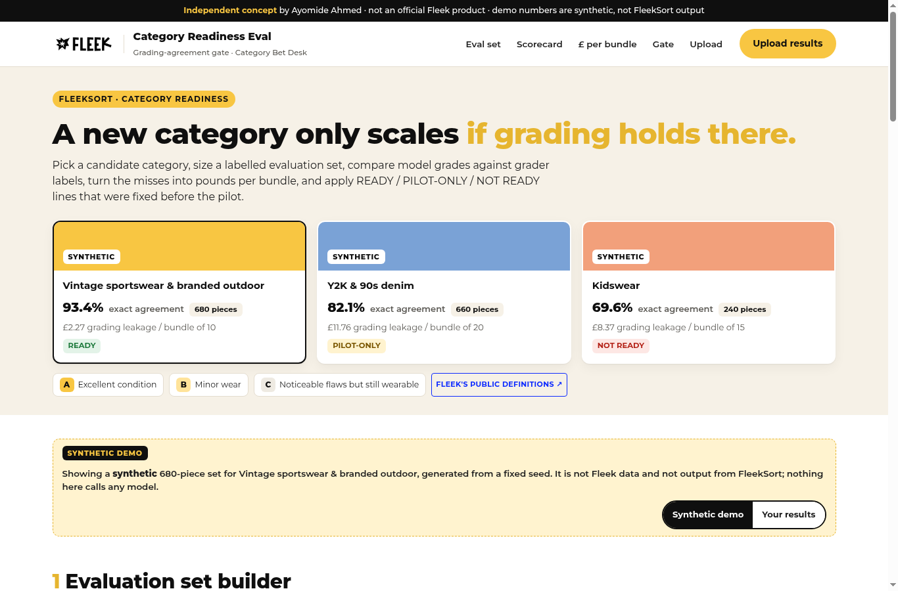

# FleekSort Category Readiness Eval

**An independent concept by Ayomide Ahmed. It is not an official Fleek product, is not affiliated with or endorsed by Fleek, and uses no Fleek internal data.** It does not call FleekSort or any other model. Every result in the demo is synthetic and labelled as such. The Fleek name and logo belong to Fleek and appear only to show how the tool would sit inside its product.

Live demo (no sign-in): **https://cashpointsoulja.github.io/fleeksort-category-readiness/**

Demo video (vertical, voiceover and subtitles): [public/media/fleeksort-category-readiness-walkthrough.mp4](public/media/fleeksort-category-readiness-walkthrough.mp4) · [raw file](https://raw.githubusercontent.com/CashpointSoulja/fleeksort-category-readiness/build/fleeksort-category-readiness/public/media/fleeksort-category-readiness-walkthrough.mp4) · [script](docs/demo-script.md)

A new category only scales if grading holds there. This tool is the gate for the grading-agreement metric in the companion [Category Bet Desk](https://github.com/CashpointSoulja/category-bet-desk). It is built for one seat: Fleek's [Special Projects Lead, Category Expansion](https://www.ycombinator.com/companies/fleek/jobs/Iopbt9d-special-projects-lead-category-expansion), who has to say whether a new category bet is ready to scale.



## What it does

Pick a candidate category: **vintage sportswear & branded outdoor**, **Y2K & 90s denim** or **kidswear**. For that category the tool shows:

1. **Evaluation set builder.** How many grader-labelled pieces each grade (A, B, C) needs for a defensible read, with the working shown: \(n = z^2 p(1-p)/E^2\). At 85% expected agreement, ±5 points and 95% confidence that is 196 pieces per grade, 588 in total. A second line sizes each failure-mode slice so a rare miss is seen at least once.
2. **Grading-agreement scorecard.** Model grade against the grader's label for the same piece: a 3×3 confusion matrix, exact agreement, within-one-grade agreement, over-grade and under-grade rates, each with its denominator and a Wilson confidence interval, plus agreement per grade. Each miss type gets an expected-value cost: over-grading causes disputes and refunds, under-grading leaves money on the table.
3. **Dispute leakage and price realisation.** The same misses priced for one bundle: refunds and handling on disputed over-grades, value lost on under-graded pieces, realised value against the value if every piece carried the grader's grade. Inputs are labelled Sourced, Estimated or Placeholder.
4. **Readiness gate.** READY, PILOT-ONLY or NOT READY against thresholds that are locked before the pilot (unlocking them shows a warning). READY needs every line to hold on the confidence bound with enough pieces per grade; PILOT-ONLY needs the point estimates to clear the pilot lines. A failure-mode table checks lighting and photo quality, dirty stock, unseen garment types and mislabelled brand, so a weak slice cannot hide inside a good average.
5. **Upload your own results.** A CSV mode with a downloadable template. The file is parsed in the browser (nothing is sent anywhere); bad rows are listed by line and left out, and a repeated `piece_id` is left out entirely.

## The synthetic demo

The three preloaded result sets are **synthetic**: generated from fixed seeds in [`lib/synthetic.ts`](lib/synthetic.ts), with piece IDs starting `SYN-`. They are not Fleek data and not FleekSort output. They are tuned to show each verdict:

| Category | Pieces (A / B / C) | Exact agreement | Within one | Leakage per bundle | Verdict |
|---|---|---|---|---|---|
| Vintage sportswear & branded outdoor | 680 (230 / 240 / 210) | 635 / 680 = 93.4% | 680 / 680 | £2.27 of £119.96 (bundle of 10) | READY |
| Y2K & 90s denim | 660 (210 / 250 / 200) | 542 / 660 = 82.1% | 657 / 660 | £11.76 of £217.05 (bundle of 20) | PILOT-ONLY |
| Kidswear | 240 (70 / 95 / 75) | 167 / 240 = 69.6% | 238 / 240 | £8.37 of £91.13 (bundle of 15) | NOT READY |

Denim holds on the pilot lines but misses READY because poor-photo pieces agree only 67.0% (212 pieces). Kidswear fails on sample size, over-grading (16.7%) and leakage (9.2% of bundle value), with dirty stock at 40.6% exact.

## Honesty rules

- Fleek's public grade definitions are used as written: A = excellent condition, B = minor wear, C = noticeable flaws but still wearable ([joinfleek.com](https://www.joinfleek.com/)).
- Price anchors come from public Fleek listings, converted at an estimated 0.75 £/$. Dispute chances, refund share and handling cost are not public, so they are placeholders and say so.
- Default thresholds are a proposal, set relative to the public "82% accuracy" figure on the [careers page](https://www.joinfleek.com/careers). They are not Fleek policy.
- Every public fact is in [docs/source-ledger.md](docs/source-ledger.md).

## Run it

```bash
npm ci
npm run dev          # http://localhost:3000
npm test             # 46 unit tests: the maths against hand-calculated cases
npm run typecheck
npm run build        # static export to out/
npm run build:pages  # same, with the /fleeksort-category-readiness base path for GitHub Pages
```

Next.js 14 (App Router, static export) and TypeScript. The maths is pure functions in [`lib/`](lib): [`stats.ts`](lib/stats.ts) (sample size, Wilson intervals), [`agreement.ts`](lib/agreement.ts) (confusion matrix, rates, failure-mode slices), [`economics.ts`](lib/economics.ts) (miss costs, leakage, realisation), [`gate.ts`](lib/gate.ts) (verdict) and [`csv.ts`](lib/csv.ts) (upload parsing). Pushes run typecheck, tests and the Pages build in [GitHub Actions](.github/workflows/pages.yml).

## Docs

| Doc | |
|---|---|
| [PRD](docs/prd.md) | Problem, user, scope, requirements |
| [Five Whys](docs/five-whys.md) | Why a category can scale before anyone knows grading holds |
| [Jobs to be done](docs/jtbd.md) | The bet owner's jobs and the people around them |
| [Success metrics](docs/success-metrics.md) | How we would know the gate works |
| [Eval methodology](docs/eval-methodology.md) | Sampling, metrics, cost model, gate rules and their limits |
| [Test plan and results](docs/test-plan.md) | What was tested and the recorded output |
| [Viability memo](docs/viability-memo.md) | Why this matters for the Special Projects Lead role |
| [v2 roadmap](docs/roadmap-v2.md) | What comes next |
| [Demo script](docs/demo-script.md) | Timed voiceover for the vertical video |
| [Brand sheet](docs/brand-sheet.md) and [visual guide](docs/visual-guide.md) | Fleek's public look, reused from Category Bet Desk |
| [Source ledger](docs/source-ledger.md) | Every public source and what was taken |

---

Independent concept by Ayomide Ahmed. Not an official Fleek product.
