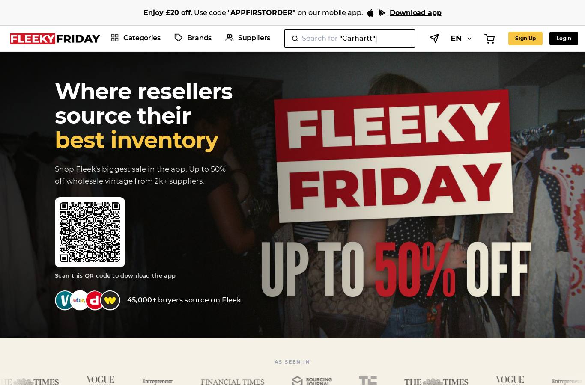
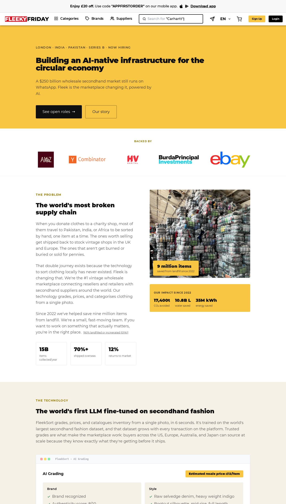
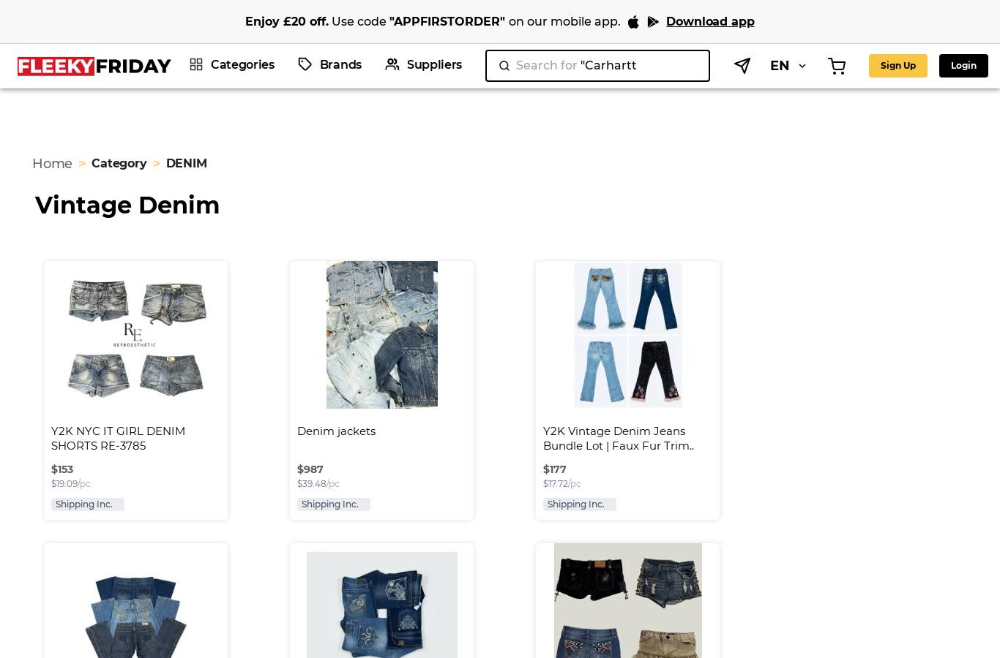
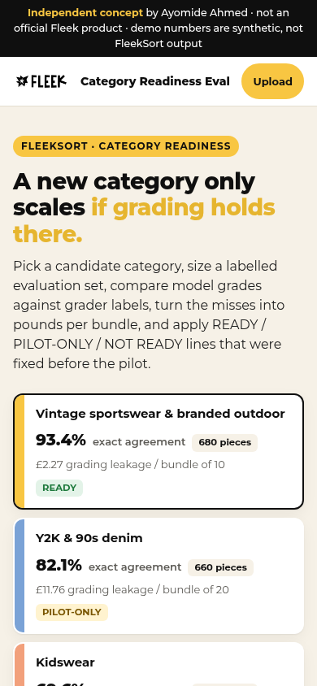
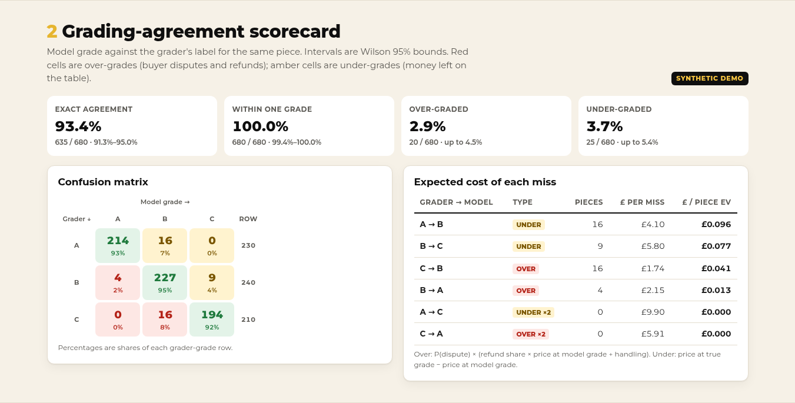
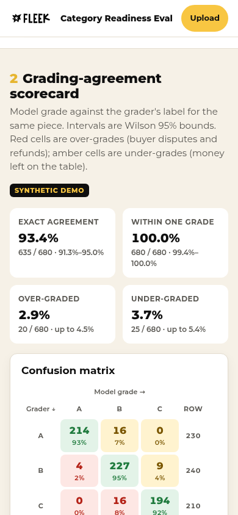
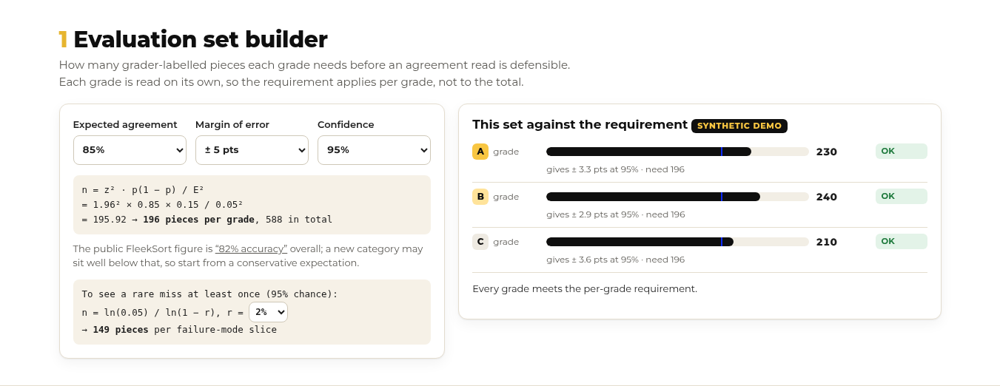
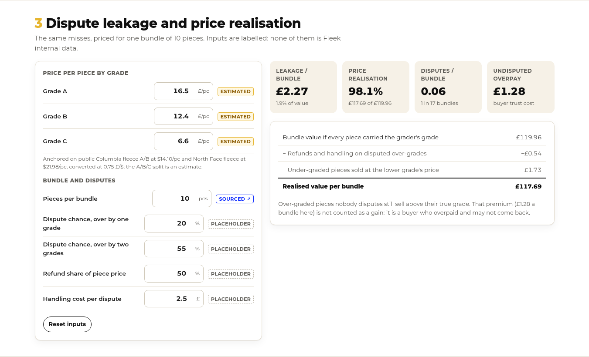
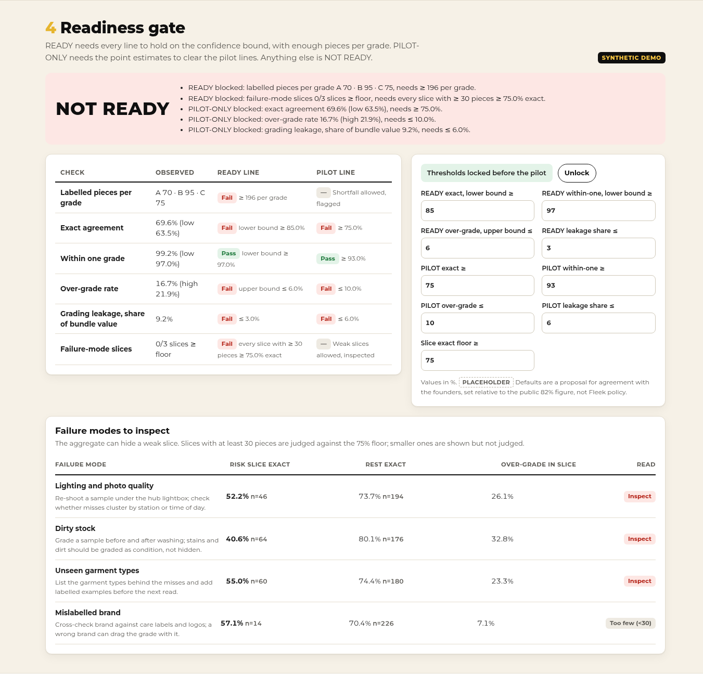
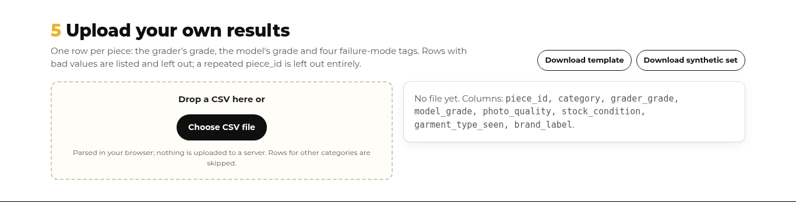

# Visual guide

How the readiness eval borrows Fleek's public look, screen by screen. Read with [brand-sheet.md](brand-sheet.md). The reference captures are the ones taken for Category Bet Desk (6 October 2026, public pages, no sign-in).

| Fleek page | Capture | What we took from it |
|---|---|---|
| Home, 1366 px |  | White header, logo top-left, pill buttons, bold headline with one yellow phrase |
| Home, 390 px |  | Single column, logo row, full-width cards, no horizontal scroll |
| Careers, 1366 px |  | Yellow and cream bands, tracked eyebrow labels, stat tiles with one big number |
| Denim category, 1366 px |  | Listing card: tile, badge, title, bold figure, grey secondary line, chip |

## Layout rules

1. **Logo** top-left in the sticky white header; independence strip above it on every screen.
2. **Hero** on cream: eyebrow pill, headline "A new category only scales *if grading holds there.*", then the three category tiles and the A/B/C grade pills.
3. **Synthetic banner** directly under the hero, with the Synthetic demo / Your results switch.
4. **Sections numbered 1-5** in dark yellow: evaluation set builder, scorecard, £ per bundle, readiness gate, upload. Alternating white and cream bands.
5. **Every rate** shows numerator / denominator and its interval; every £ input shows its label.
6. **Confusion matrix** cells: green diagonal, red over-grades (model better than grader), amber under-grades.
7. **Mobile 390 px**: one column, header shows logo, title and the yellow Upload button; wide tables scroll inside their card, the page never scrolls sideways.

## Our screens

| Desktop 1366 px | Mobile 390 px |
|---|---|
|  |  |
|  |  |

Builder: 

£ per bundle: 

Gate, kidswear NOT READY: 

Upload: 

## What we did not copy

- Seasonal sale lockups, search, sign-in, cart and supplier navigation.
- Product photography: category tiles use flat brand colours.
